# genealogy-evidence-pipeline

Grows a family tree only from records: AI agents propose additions, free Python checks what code can check, a second model tries to refute each claim, and accepted facts go into an append-only ledger with the quote they rest on.

**Plain-words write-up:** [A family tree built only from real records](https://ryanwisth.github.io/evidence-pipeline.html)

## Why it exists

Online family trees copy each other. A "source" on a big genealogy site is often just another user's tree, so two trees agreeing is not evidence; it is often the same mistake copied twice. This project extends a tree the other way round. Every new person, parent link or date must cite a primary record (a register entry, a census line, a headstone), quote it, tie it to the tree person by at least two identifiers, and survive an adversarial check. Nothing in the original tree is ever deleted. It came out of cleaning and then researching a private tree with tens of thousands of records. This repository runs end to end on an invented 420-person family.

```mermaid
flowchart LR
  A[Messy GEDCOM export] --> B[dup_scan + adjudicate]
  B --> C[clean_tree: lossless merge]
  C --> D[verify_clean: nothing dropped]
  D --> E[build_targets: dossiers + roster]
  E --> F[Finder agents: proposals only]
  F --> G[gate_claims: free checks + quote match]
  G --> H[Skeptic agents: refute or reject]
  H --> I[merge_round: append-only ledger]
  I --> J[apply_additions: new GEDCOM]
  J --> K[lint_tree + ledger_report]
  K --> E
```



## Features

- **Duplicate cleanup** for messy GEDCOM exports: pair scoring on names, dates, places and relatives, run to a fixed point; hard blockers against wrong merges; a lossless merge; a verifier that proves every person and fact survived.
- **Research targets in Python**: dead-end ancestors, a link audit and date fixes, routed into lanes by place, with compact dossiers so agents do not decode the tree themselves.
- **Finder and skeptic agent scripts** (Claude Code workflow scripts) with structured JSON schemas for proposals and verdicts.
- **A free gate between the two agent waves**: drops claims that cite no record, have fewer than two identifiers, repeat a ledger fact, duplicate an existing child, or add a living person; checks every quote against the saved page.
- **Append-only ledger**: each item stamped with its round and entry id; the new GEDCOM is regenerated from base + ledger and checked (every base line survives, every pointer resolves).
- **Date lint** on the root person's line, and a per-person checklist of what to enter back in the source tree.

## How it works

**Agents propose; code checks what code can check.** Agent turns are the cost. On the private tree, round 2's finders averaged 78 turns. By round 3, dossiers, the gate and short review sheets had moved work into Python, and the round ran at about 57k tokens per target. These figures come from the project's notes on that private tree; the demo does not reproduce them.

**A second model tries to refute.** In round 1 the skeptics rejected 31 claims from a fast first pass and 3 of 147 from a careful one (measured on the private tree). The skeptic's stance is "when you cannot confirm, reject".

**Quote matching is a window, not a phrase.** Record pages lay values out as `Label: value`, so a faithful quote is rarely a contiguous string. The gate folds case, accents and punctuation, ignores field labels, and looks for 80 % of the distinctive words inside one window. A miss flags the claim for the skeptic rather than dropping it.

**Nothing is deleted.** Disproved parent links are recorded in `disputes.json` and cut in later counts; corrections become notes. The base GEDCOM is never edited.

**Offline by default.** The gate reads saved page text. `--fetch` is opt-in, with a user agent naming this project, a fixed delay and a request cap. Record pulls were done by separate private scripts and are not part of this repository.

More: [evidence rules and ledger contract](docs/evidence-rules.md), [research rounds and lessons](docs/research-rounds.md), [cleanup](docs/cleanup.md).

## Quick start

Requirements: Python 3.9+ (standard library only) and bash. No network and no AI model are used.

```
./run_demo.sh            # writes everything to ./work (recreated each run)
python3 tools/test_rules.py
```

`run_demo.sh` generates the invented inputs (`tools/make_demo_research.py`), then runs the cleanup half and the research half. The skeptic step needs Claude, so the demo uses a committed fixture, `sample/research/round1/skeptic-verdicts.json`, in its place. Key lines from a run:

```
# 3 merge clusters covering 6 records            (dup_scan: 3 injected duplicates)
individuals_out 420 ... validation: clean        (clean_tree: 423 -> 420)
checked 3 merged individuals — 0 lost a fact     (verify_clean: PASSED)
| lane-a | 5 | 4 | 0 | 3 | 12 | 4 | not-fetched 1, quote-found 2, quote-missing 1 |
total new: 4 people, 2 families, 2 facts, 1 notes, 2 sources
wrote .../tree-research.ged: +4 people, +2 families, +2 sources, 20 lines added to 3 existing records
lint: 2 on the direct line, 2 among their children
ancestors 24  dead ends 13  targets 16 in 7 agents  overflow 4  excluded 0
```

The gate kept 12 of the journal's 16 claims and dropped 4: a child already in the tree, its parent link, a living person, and a fact citing only an online tree. The lint's first hit is real: the invented baptism is dated before the sample tree's birth date for that person, which is the kind of lead the lint exists to raise. Selected outputs are in `demo/`.

The research view is built with `tools/build_tree_view.py` and its helpers, copied from the companion repository family-tree-3d so the two agree on the payload format. That was smaller than writing a second view builder.

To run the agents on your own tree, launch `agents/finder.js` with `{workspace, round, roster}` and `agents/skeptic.js` with `{workspace, round, lanes}` from Claude Code's workflow runner, then run `gate_claims.py` and `merge_round.py` as in `run_demo.sh`.

## Project structure

```
run_demo.sh                 the whole pipeline on invented data, offline
agents/finder.js            wave 1: finder agents (proposals only)
agents/skeptic.js           wave 2: skeptic agents (refute, then write ledger entries)
tools/
  repair_structure.py       make an export parseable without losing bytes
  dup_scan.py, adjudicate.py, make_verify_pack.py, collect_verdicts.py
  merge_gedcom.py, clean_tree.py, verify_clean.py
  tree-audit.py, relationship-path.py
  build_targets.py          targets, lanes, dossiers, roster
  gate_claims.py            the free gate between the agent waves
  merge_round.py            skeptic verdicts -> ledger (validated, append-only)
  apply_additions.py        base GEDCOM + ledger -> new GEDCOM
  lint_tree.py, ledger_report.py
  build_tree_view.py, build_details.py, build_stats.py, contract.py   view payload builder
  gedcom_lib.py, evidence.py, workspace.py                           shared helpers
  make_demo_research.py     invented demo inputs (fixed seed)
  test_rules.py             rule regression checks
sample/                     invented family, injected duplicates, journal, pages, fixture verdicts, lanes.json
demo/                       outputs from one demo run
docs/                       evidence rules, research rounds, cleanup
```

## Status and limits

The pipeline ran three research rounds on a private tree in September 2026, and the cleanup half ran on its full export. This public copy is a scrubbed version: paths, names and tree-specific tables were replaced by command-line flags and a config file, and the demo is the test that it still runs. Known limits:

- The agent scripts need Claude Code's workflow runtime and were not re-run after the scrub; they pass a syntax check only.
- The demo's dup_scan cases are all clear (AUTO), so the review and agent-judgment path of the cleanup (`adjudicate.py` dossiers, `collect_verdicts.py`) is not exercised by the demo.
- There is no record-pulling code here; you supply saved page text.
- MyHeritage-specific handling (export repairs, Smart Match source labels, the ledger checklist) is format support; other exports may need their own repairs.

## How this was built

Ryan Wisth built this by directing AI coding agents (Claude Code). He set the goals, the evidence rules and the acceptance checks, and verified the results; the agents wrote most of the code.

## License

MIT; see [LICENSE](LICENSE). Not affiliated with MyHeritage, FamilySearch, Ancestry, Geni, WikiTree or any archive; their names appear only to describe file formats and the rule that user trees are leads, not sources. All people, places and records in `sample/` and `demo/` are invented.
